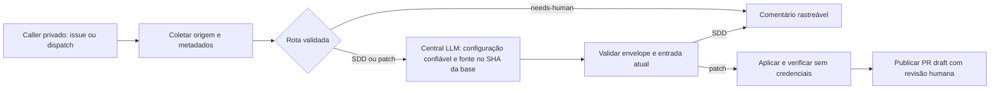

# Triagem Design

**Spec:** [spec.md](spec.md). **Status:** Proposta técnica para revisão; escopo aprovado em 2026-10-14.

## Architecture Overview

Recomendação: caller privado → workflow reutilizável de triagem → workflow central LLM. Triagem possui coleta, roteamento e publicação; central conserva autenticação, execução read-only e resultados. Jobs distintos não compartilham workspace: contexto e artefatos são contratos explícitos. Nenhum código da issue/patch executa junto de credenciais de escrita ou sessão Codex.

| Alternativa | Trade-off |
| --- | --- |
| Extensão compatível da central, chamada aninhada | Recomendada: preserva reuso e permite evento de issue e base Git Flow, com migração explícita do envelope |
| Ponte por workflow_dispatch e coleta posterior | Preserva executor antigo, mas acrescenta correlação entre runs, polling e credencial para dispatch; ainda precisa resolver SHA de release |
| Executar scripts centrais diretamente em cada job de triagem | Evita chamada aninhada, mas duplica o ciclo operacional de sessão e rompe o objetivo de reutilizar o workflow da #9 |

## Code Reuse Analysis

| Component | Location | Reuso |
| --- | --- | --- |
| Arquivos confiáveis/configuração fechada | `scripts/llm/validate-request.mjs` | Leitura com limite, symlinks recusados, validação antes de auth |
| Origem/API | `scripts/llm/preflight.mjs` | Endpoint GitHub fixo, prazo e retry limitado para GET |
| Autenticação/fila/persistência/limpeza | `scripts/llm/auth.mjs`, `check-session-freshness.mjs`, `persist-session.mjs` | Um ciclo por consumidor; reconsulta final mesmo sem refresh |
| Modelo/prompt/executor | `scripts/llm/execute.mjs`, `orchestrate.mjs` | Sem instalar outro Codex, ferramentas desabilitadas e sem repetir auth |
| Envelope/patch | `scripts/llm/result.mjs` | Validação antes de aplicação; nenhuma confiança em proveniência declarada pela LLM |
| Caller e inspector | `examples/callers/llm/` | Adaptar gatilho/configuração e validação, mantendo referência imutável |

Node 22.23.3, dependências fixadas e testes `node:test` já presentes. Não acrescentar framework, harness ou provedor.

## Components

| Componente | Localização prevista | Interface / responsabilidade |
| --- | --- | --- |
| Contrato e política | `scripts/triage/policy.mjs` | Validar configuração v1, metadados normalizados e decidir plan / propose-patch / needs-human |
| Coletor | `scripts/triage/collect.mjs` | Consultar issue, ator, milestone, épica, dependências e Project configurado; devolver contexto limitado e fingerprint |
| Adaptador central | `scripts/llm/` | Aceitar perfil triage explícito com origem validada e separar checkout de configuração do checkout de código |
| Preparação de patch | `scripts/triage/prepare-patch.mjs` | Validar/applicar diff sobre SHA esperado em workspace isolado, produzir commit proposto e comprovar alteração |
| Publicação | `scripts/triage/publish.mjs` | Revalidar entrada/base, recuperar recursos pelo marcador e publicar comentário/branch/PR sem sobrescrever conteúdo humano |
| Workflow e runner | `.github/workflows/issue-triage.yml`, `scripts/triage/run.mjs` | Coordenar jobs de leitura, LLM, verificação sem secrets e publicação; estado final explícito |

## Data Models e contrato

- Configuração do consumidor na branch padrão: projeto owner/number, mapeamento explícito de campos, configs/prompts centrais de planejamento e patch, allowlist de bases empilhadas, reviewer humano e comandos de verificação. Schema fechado, até 32 KiB; não aceitar nomes de campos/runners/comandos vindos do body.
- Normalização: issue number/node ID/state/body/updated_at/type/milestone, épica, blockers com state, campos Effort/Size/Estimate/Release e fonte de cada campo. API inacessível não inventa valor; informação insuficiente leva a needs-human. Body até 16 KiB; contexto completo até 32 KiB, sem truncamento.
- Rota simples somente Bug/Task + Effort Low + XS/1 ou S/2 + sem Release MAJOR + sem blocker aberto + base inequívoca. Metadados completos fora dessa combinação geram planejamento; metadados insuficientes geram needs-human. O domínio impõe a rota; LLM não amplia autorização.
- Base: release existente derivada da milestone ou branch empilhada explicitamente autorizada pela configuração. Nunca master como destino automático; SHA é consultado pela API, não pelo texto da issue.
- Identidade lógica de publicação: repositório + issue; fingerprint do resultado: hash do body, metadados relevantes e SHA da base. Run/attempt/invocation_id identificam a inferência, não substituem a deduplicação de recursos GitHub.

## Extensão da central sem quebrar callers existentes

1. Manter dispatch atual e envelope v1 para o caller legado. Novo perfil triage explicitamente selecionado aceita `issues.opened` ou dispatch com issue number; a API confirma origem, issue e autorização write/maintain/admin antes de auth. Só remover o teste de bloqueio global de issues não seria suficiente nem aceitável.
2. Checkout de configuração/prompt/diretrizes na revisão confiável da branch padrão, separado do checkout de código no SHA da base autorizada. O adaptador resolve autorização da base usando configuração confiável e metadata; parâmetros não autorizam branch arbitrária.
3. Envelope v2 da integração carrega os campos v1 e `config_source_sha` obrigatório, além de `source_sha` da base. Schema v2 fechado e inspector versionado; execução antiga continua v1. Configuração e diretrizes preservam hashes de conteúdo. LLM nunca fornece esses campos de proveniência.
4. Arquivo de resultado continua até 1 MiB, summary até 4000 caracteres, outputs até 8 KiB e retenção de 1 dia. Planejamento é resumo SDD rastreável, não documento ilimitado ou aprovação automática de TLC.

## Publicação e verificações

- Planejamento/needs-human: comentário com marcador estável da automação, resumo SDD ou informações faltantes, entrada/revisão e aviso de rascunho. Atualizar somente comentário comprovadamente da identidade configurada da automação; não assumir propriedade só por texto do marcador.
- Patch: validar envelope esperado, allowlist central + escopo do consumidor e `git apply --check` sem shell/interpolação do patch. Recusar symlink/submódulo/binário/workflow/auth/config/diretrizes, patch vazio e código de base divergente.
- Job sem sessão/PAT de secrets/credenciais de escrita executa comandos confiáveis do consumidor. Dependências do produto só são instaladas nesse job isolado; publisher não executa scripts/hooks/código de produto.
- Publicação recebe apenas credencial do consumidor com escrita em contents/issues/PR; coletor recebe token de leitura de metadados/Project. PAT de secrets só vai ao job central. A cadeia de workflow_call não eleva GITHUB_TOKEN; caller declara permissões máximas e cada fase reduz o que recebe.
- Criar PR draft com Refs, milestone e reviewer. Não usar Closes em base intermediária, não autoaprovar/mesclar, não mover Ready/Done. Base avançada impede publicação e exige nova análise. Commit/ref/PR existentes exigem identidade/hash esperados; sem force-push ou alteração de commits humanos.
- Escrita GitHub não tem transação/CAS geral: serializar por issue, reconsultar estado imediatamente antes da escrita e reconciliar após falha ambígua. Recursos órfãos próprios são recuperados pelo marcador, nunca recriados cegamente. Resultado de conflito permanece falha, não sucesso atômico fictício.

## Error Handling Strategy

| Caso | Resultado |
| --- | --- |
| Origem/configuração inelegível | Falhar antes de auth, sem publicação privilegiada |
| Metadados insuficientes | needs-human sem patch; explicar campos necessários |
| Entrada/issue/base mudou | STALE_TRIAGE_INPUT; não publicar proposta antiga |
| 403/429, timeout ou escrita ambígua | Erro sanitizado; recuperar recursos antes de repetir escrita |
| Falha de teste | PR permanece draft com resultado explícito; nunca vira aprovação |
| Conflito/erro de persistência da sessão | Central falha, não usar artefato; nova execução ou reprovisionamento pelo mantenedor |

## Risks & Concerns

| Concern | Location | Impact | Mitigation |
| --- | --- | --- | --- |
| Só dispatch/default SHA hoje | `scripts/llm/preflight.mjs:34`, `run.mjs:39` | Triagem direta rejeitada ou patch atribuído à base errada | Perfil validado, checkouts separados e envelope v2 |
| Schema v1 fechado | `scripts/llm/result.mjs:12`, `schemas/result.schema.json` | Campo novo quebraria callers anteriores | Novo schema discriminado; manter v1 para callers antigos fixados |
| Projeto/metadados de cada org diferentes | `spec.md`, TRI-08 | Rotas inventadas ou permissões excessivas | Mapeamento explícito; ausência/inconsistência não autoriza correção |
| Projeto pode exigir token próprio | API GitHub | GITHUB_TOKEN de repo não garante leitura de Project | Token de leitura do consumidor restrito à coleta; erro explícito |
| Publicação duplicada/edição humana concorrente | `spec.md`, TRI-19/21 | Sobrescrever proposta ou código humano | Proveniência de autoria, serialização e recusa de divergência |
| Piloto sem credenciais ainda | `spec.md`, TRI-24/25 | Fixtures não comprovam serviço real | Homologação pelo mantenedor no mesmo caller, antes de considerar a entrega completa |

## Testes e sequência de entrega

Testes por comportamento: roteamento completo/insuficiente, origem recusada, SHA/configuração divergente, preservação do dispatch v1, patch aplicado versus proibido, deduplicação/recuperação e limpeza/conflito de sessão. Sem quantidade mínima ou teste de prosa. Implementação em commits locais por componente; CI usa comandos existentes e inclui a feature. Verifier independente TLC e sensor ao final; piloto real separado de fixtures.

Ordem proposta para tarefas: política → coletor → adaptação central → preparação de patch → publicação → workflow/CI → caller → piloto. Detalhamento e gates em tasks.md somente após revisão deste design.

## Fontes verificadas

Código central e caller existentes; constituição e decisões AD-001–004. Context7 indisponível nesta sessão; fallback em [reuso e contexto do caller](https://docs.github.com/en/actions/reference/workflows-and-actions/reusing-workflow-configurations), [permissões de colaboradores](https://docs.github.com/en/rest/collaborators/collaborators#get-repository-permissions-for-a-user). Consulta da API confirmou Project da issue e Status In progress; nenhum merge do PR da central foi realizado.
