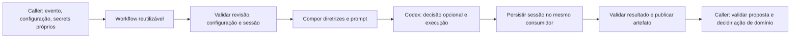

# Pipeline reutilizável de LLM Design

**Spec:** [spec.md](spec.md). **Status:** Aprovado para implementação local. **Data:** 2026-10-12.

**Recorte atualizado em 2026-10-13:** prioridade para executor, resultados, workflow central, CI, caller reutilizável e piloto usando esse mesmo caller. O caller acompanha instruções completas de configuração, autenticação, modelos/modos, consumo de resultados e recuperação. Manual central extenso e testes documentais ficam para trabalho posterior. A redução de intensidade aplica-se aos testes de baixo valor, sem reduzir a clareza das instruções do caller. Testes protegem contratos e efeitos relevantes, sem metas de contagem.

## Architecture Overview

Um workflow `workflow_call` executa um adaptador Codex no contexto do repositório consumidor. O caller escolhe a política de invocação e mapeia seus secrets; o central valida o contrato, prepara o runtime, executa e entrega dados. Nenhuma conta, sessão ou PAT do repositório central é usado para atender consumidores.

| Abordagem | Trade-off | Decisão desta proposta |
| --- | --- | --- |
| Workflow reutilizável com configuração e secrets explícitos do caller | Reusa ciclo completo; resultados cruzam jobs por artefato; autenticação temporária ocorre no job chamado | Recomendada, atende o pedido e mantém o contrato das futuras #7/#8 |
| Composite action de setup/exec dentro do job do caller | Caller controla todas as etapas e armazenamento; também assume cleanup, persistência e isolamento | Alternativa viável se for necessário setup no mesmo job; não entregar duas APIs no MVP |
| Serviço central persistente de LLM | Exige infraestrutura, identidade e armazenamento operacional próprios | Rejeitada: contraria o escopo e a propriedade de credenciais |



O desenho preserva leitura e proposta no central. Triagem/review poderão aplicar patches em jobs próprios, sem sessão da LLM ou PAT de secrets. Sandbox read-only limita escrita, mas não torna segredo legível inacessível à leitura; por isso não há execução de código não confiável, nem PAT no processo do modelo. O piloto deve verificar as proteções efetivas do CLI fixado.

## Propriedade e isolamento

| Recurso | Proprietário | Comportamento do central |
| --- | --- | --- |
| Eventos, branch confiável e seleção de configuração | Caller | Revalida contexto e resolve o SHA dessa branch |
| Modo, modelos, esforço e template | Caller | Valida campos e executa a escolha; não escolhe modelo global por aplicação |
| Sessão ChatGPT/API key | Consumidor | Materializa só no runtime temporário da chamada |
| PAT para persistência | Consumidor | Disponível apenas em preflight/persistência; nunca no processo Codex |
| Renovação interna da sessão | Codex CLI | Preserva arquivo resultante; não chama OAuth refresh diretamente |
| Destino da secret renovada | Repositório corrente do caller | Deriva de `github.repository`; não existe input para trocar owner/repo |
| Templates e diretrizes comuns | Central versionado | Distribui código/conteúdo, sem credenciais |
| Correção de código, comentário e PR | Consumidor #7/#8 | Recebe somente dados; central não possui essas permissões |

Não usar `secrets: inherit`. Não buscar credencial no `.github` central, em arquivo pessoal, em secret da organização compartilhada por aplicações ou em cache. O nome público da secret pertence à configuração; o seu valor só entra por `workflow_call.secrets`. Não duplicar a mesma sessão de refresh entre repositórios ou entre o piloto e a máquina do mantenedor: secrets separadas com tokens idênticos ainda compartilham o mesmo estado externo.

## Estrutura planejada

```text
.github/workflows/llm-execute.yml
scripts/llm/
  package.json                 # dependências e comandos próprios desta feature
  package-lock.json            # resolução exata
  validate-request.mjs
  preflight.mjs
  instructions.mjs
  auth.mjs
  check-session-freshness.mjs
  persist-session.mjs
  execute.mjs
  result.mjs
  schemas/request.schema.json
  schemas/result.schema.json
  templates/decision.md
  templates/analyze.md
  templates/propose-patch.md
  instructions/AGENTS.md
  instructions/provenance.json
tests/llm/*.test.mjs
tests/llm/fixtures/
examples/callers/llm/.github/workflows/llm.yml
examples/callers/llm/.github/llm/analyze.json
examples/callers/llm/README.md
docs/llm.md
```

Esta árvore é a implementação futura. Os protótipos nesta especificação ficam em `examples/` dentro da própria pasta TLC e terminam em `.example`, sem ativar workflows.

## Code Reuse Analysis

| Componente existente | Location | Uso / limite |
| --- | --- | --- |
| Workflow de versionamento | `.github/workflows/version-preview.yml:39` | Checkout separado de consumidor e automação; `persist-credentials: false`; identidade via `job.workflow_repository` e `job.workflow_sha` |
| Scripts ESM e testes com processo falso | `tests/versioning/go-version.mjs:1`, `tests/versioning/pr-check.mjs:1` | Reusar estilo Node e fixtures de CLI/API, sem importar regras de versionamento |
| Piloto integrado isolado | `tests/versioning/post-merge.mjs:1` | Reusar ideia de diretórios temporários; não reutilizar publicação de tags |
| Constituição | `.specify/memory/constitution.md:1` | Contratos explícitos, referências revisáveis, privilégios mínimos e docs por caller |
| AGENTS global | Fonte do mantenedor, SHA registrado abaixo | Copiar integralmente na implementação, preservar proveniência e sincronização por revisão |

Sem dependência funcional de #4 ou #5. A issue #9 fornece o contrato que #7/#8 consumirão. Os planejamentos dessas branches precisam adotar o contrato novo quando forem retomados.

## Contrato público do workflow

### Inputs

| Input | Tipo / padrão | Valores e efeito |
| --- | --- | --- |
| `invocation_id` | string, obrigatório | Identificador estático escolhido pelo caller, único entre chamadas deste workflow no mesmo run; `[a-z][a-z0-9-]{0,47}`; diferencia outputs/artefatos de jobs que reutilizam o mesmo central |
| `config_path` | string, obrigatório | Caminho relativo de JSON versionado no consumidor; regular, sem symlink, sem `..`, sem caminho absoluto; máximo 240 caracteres |
| `source_ref` | string, obrigatório | Branch confiável definida estaticamente pelo caller; MVP exige branch padrão; resolve para SHA antes do checkout |
| `context_json` | string, padrão `{}` | Objeto JSON de até 32768 bytes UTF-8; dado para análise, nunca shell, política ou configuração |
| `auth_mode` | string, obrigatório | `chatgpt-session` ou `api-key`; sem seleção automática |
| `session_secret_name` | string, padrão vazio | Obrigatório apenas para sessão; nome de repository secret em maiúsculas `[A-Z][A-Z0-9_]{0,99}`, sem prefixo `GITHUB_`; determina lock e destino de persistência |

`github.repository`, `run_id`, `run_attempt` e timestamps vêm da plataforma. Não aceitar como input autoridade para operar outro repositório. O workflow usa `ubuntu-24.04`; suporte a runners arbitrários fica fora do primeiro MVP.

### Secrets

| Secret de interface | Quando requerida | Limite / escopo |
| --- | --- | --- |
| `CODEX_AUTH_JSON` | `chatgpt-session` | Sessão gerenciada com `auth_mode=chatgpt`, JSON até 48 KiB, repository secret do próprio consumidor |
| `CODEX_AUTH_WRITE_PAT` | `chatgpt-session` | Fine-grained PAT com `Secrets: write` apenas nesse repositório; aprovação da org se exigida |
| `OPENAI_API_KEY` | `api-key` | Chave do consumidor; faturamento separado só se ele escolher essa modalidade |

Todos são `required: false` no YAML porque a combinação depende de `auth_mode`; a validação condicional exige exatamente o conjunto correto. `GITHUB_TOKEN` recebe `contents: read` e `actions: read`. Não recebe escrita de contents/issues/PRs. O PAT não é uma identidade de inferência.

GitHub não informa ao workflow se dois secrets iguais vieram da mesma sessão, nem prova que o PAT foi limitado a um único repo. O provisionamento e o teste de adoção verificam isso; o script também fixa todos os destinos ao repo corrente. Secrets de environment com nomes sobrepostos não são suportadas neste contrato inicial.

### Configuração de invocação do caller

O JSON usa schema fechado (`additionalProperties: false`):

```json
{
  "schema_version": 1,
  "invocation_mode": "decision-then-prompt",
  "decision": { "model": "MODELO_HABILITADO_NA_CONTA", "effort": "low", "template": "decision" },
  "execution": { "model": "MODELO_HABILITADO_NA_CONTA", "effort": "medium", "template": "analyze" }
}
```

`single` exige somente `execution` e proíbe `decision`. `decision-then-prompt` exige ambos. Modelo deve ser identificador com até 128 caracteres, sem whitespace/opções de shell; disponibilidade real é validada no piloto. Effort: `low`, `medium`, `high`; aceitar apenas combinações verificadas com a versão fixada do CLI. Modelo não disponível falha, nunca troca silenciosamente por outro. Templates de execução: `analyze` e `propose-patch`; decisão usa `decision`. Templates não selecionam modelo.

Contexto chega por stdin/arquivo JSON delimitado. Nenhum `eval`, `bash -c` ou concatenação de contexto em comandos. O processo é iniciado com argumentos separados. O central não recebe comando livre, endpoint de provedor nem script de autenticação executável do caller.

A primeira resposta de `decision-then-prompt` usa schema fechado com `decision` (`proceed`, `skip`, `needs-human`) e `reason` (string até 2000 caracteres). JSON inválido encerra com `INVALID_RESULT`, sem segunda chamada. `proceed` seleciona somente o prompt já configurado em `execution`; a LLM não escolhe novas ferramentas, modelos, credenciais ou comandos. A resposta final do modelo contém `summary` e `patch` (string ou null); o executor valida conteúdo e constrói a proveniência separadamente.

## Components

| Componente | Interface / responsabilidade | Dependências |
| --- | --- | --- |
| `validate-request.mjs` | `validateRequest(config, inputs)` produz objeto normalizado ou erro; valida esquema/caminhos/limites | Node, Ajv |
| `preflight.mjs` | `verifyContext(event, metadata)` resolve branch/SHA confiável e nega execução insegura | API GitHub, Git |
| `instructions.mjs` | `prepareInstructions(root, global, limit)` resolve cadeia de AGENTS conforme CLI fixado, soma bytes e registra hashes | Node fs/crypto |
| `auth.mjs` | `restoreAuth(mode, secret)` e `cleanupAuth(dir)` delimitam ciclo de credencial | Node fs, diretório temporário privado |
| `check-session-freshness.mjs` | `checkFreshness(secretMetadata, runMetadata)` recusa snapshot potencialmente antigo | REST metadados de secret/run |
| `persist-session.mjs` | `persistIfChanged(oldHash, newFile, target, expectedUpdatedAt)` criptografa e atualiza somente o consumidor | Node fetch, libsodium-wrappers |
| `execute.mjs` | `executeRequest(request, context)` executa 1 ou 2 chamadas, timeout agregado e ambiente mínimo | Codex CLI fixado, Node child_process |
| `result.mjs` | `validateAndPackage(result, provenance)` valida envelope, patch e lista de arquivos publicáveis | Ajv, Node crypto |
| `llm-execute.yml` | Ordena etapas, lock, cleanup, outputs e artefato; finaliza falha após tentar persistência | Actions fixadas por SHA |

Manter módulos pequenos por responsabilidade e testes junto da tarefa correspondente. Não transformar os scripts em framework de provedores no MVP.

## Ciclo de sessão e concorrência

1. O job chamado usa um grupo derivado do repo e do nome normalizado da secret: `llm-session-<repo>-<secret>`. Em API key, grupo por execução evita serialização global acidental. `queue: max`, `cancel-in-progress: false`; caller não repete o mesmo lock no nível superior, evitando deadlock/cancelamento entre caller e called.
2. Antes do CLI, consultar metadados da secret usando PAT e `created_at` da execução usando `GITHUB_TOKEN`. Se `secret.updated_at >= run.created_at`, metadata ausente ou timestamp inválido, terminar `AUTH_SNAPSHOT_STALE`. Comparação conservadora na mesma precisão de segundos, incluindo igualdade.
3. Esse guard é uma proteção conservadora, não uma API para recuperar o token mais recente. Run antigo ou rerun pode continuar inválido: disparar **nova execução**, com novo run_id, depois da persistência. Não alegar FIFO nem exactly-once.
4. Restaurar JSON no diretório exclusivo de auth do runner, modo 0700/0600. `CODEX_HOME` é configurado somente como variável de ambiente do processo lançado, apontando para esse diretório. Não reutilizar o home pessoal do mantenedor.
5. Executar Codex. Em caso de erro de inferência, ainda verificar eventual refresh e preservar a sessão válida modificada. Nunca persistir arquivo inválido nem sobrescrever com o seed original.
6. Reconsultar metadata antes da escrita. Se mudou desde o preflight, falhar `AUTH_STATE_CONFLICT`, sem sobrescrever intervenção externa. Fora do job, manutenção da secret deve pausar callers: REST Secrets não tem compare-and-swap, então esse guard não elimina corrida com escrita externa concorrente.
7. Se o hash privado do conteúdo mudou, criptografar com sealed box usando a chave pública do repo e atualizar a mesma secret. Se inalterado, não escrever; evita invalidar runs enfileirados sem necessidade. Não publicar hashes de credenciais.
8. Falha de persistência invalida resultado mesmo com resposta do modelo válida. Limpar temporários via `always()` e encerramento do processo. Cancelamento forçado/perda de runner não garante persistência: recuperar manualmente antes de reativar.

Limite da fila é o documentado pela plataforma; excesso aparece cancelado, não como resultado da LLM. Uma sessão por fluxo serializado; cópias da mesma sessão em repositórios diferentes são proibidas no procedimento de adoção.

## Prompts, AGENTS e execução

Fonte global observada nesta revisão: `C:/Users/gerso/.agents/AGENTS.md`, 25298 bytes, SHA-256 `38ebd29a0c12506b5e53459d9a1add7734b19c56cca5fcc500302904d4cacf81`. A implementação copia o conteúdo integral para `scripts/llm/instructions/AGENTS.md` e cria proveniência com hash, data e versão. Atualização exige revisão; não há sincronização automática da máquina pessoal.

T3 versionou o texto integral normalizado de CRLF para LF, com igualdade textual verificada: 24980 bytes, SHA-256 `5e5d5640dcb6827ff8df7a01e745c7027893483091791b7f01ac163166a3c40a`. `provenance.json` registra ambos os hashes e a transformação; `.gitattributes` local mantém LF no snapshot, evitando mudanças de hash entre Windows e Linux. Nenhuma regra foi reduzida. Nenhuma skill pessoal é instalada automaticamente.

Carregar instruções de projeto da revisão confiável selecionada pelo caller, respeitando descoberta e overrides do CLI fixado. Validar limites antes de invocar, configurar `project_doc_max_bytes` suficiente e impedir symlinks para fora da raiz. Skills referidas no global não são automaticamente distribuídas: documentação lista as disponíveis; o MVP não promete acesso às skills locais.

Codex recebe diretório de trabalho de leitura e credencial de inferência mínima. Não executar hooks/build/tests do consumidor. Não herdar `.codex/config.toml`, MCPs, plugins ou comandos arbitrários do checkout: usar cópia controlada dos arquivos necessários e configuração gerada pelo central, verificada por teste de isolamento do CLI. Permissões efetivas de rede e sandbox devem ser testadas; AGENTS é orientação, não controle de acesso.

Autenticação e fonte de automação ficam fora da árvore de contexto. O ambiente do processo usa allowlist: runtime necessário, auth selecionada e locale; exclui PAT, `GH_TOKEN`, `GITHUB_TOKEN`, tokens de artifacts e credenciais de checkout. Logs brutos do CLI ficam temporários, não em stdout do job. Mensagens públicas são códigos e contagens. Mascarar componentes de tokens conhecidos antes de qualquer log auxiliar; redaction não substitui isolamento.

## Outputs e Data Models

Outputs pequenos: `status`, `decision`, `artifact_name`, `source_sha`, `automation_sha`, `request_id` e `error_code`. Total de até 8 KiB. Texto livre e patch permanecem no artefato. `status`: `succeeded`, `skipped`, `needs-human`, `failed`. `decision`: `proceed`, `skip`, `needs-human`, `none`.

Envelope validado em `result.json` inclui `schema_version: 1`, os campos acima, `repository`, `run_id`, `run_attempt`, `invocation_id`, `config_sha256`, `instructions_sha256`, `summary` (até 4000 caracteres) e `patch_file` (`proposal.patch` ou null). Identidade/proveniência são preenchidas pelo executor, nunca aceitas da LLM. `request_id` inclui run_id/attempt/invocation_id e SHA de fonte para distinguir chamadas e reruns. O identificador interno do job chamado não basta: duas chamadas do mesmo workflow reutilizam esse nome.

Artefato chamado `llm-<run_id>-<attempt>-<invocation_id>`, retenção 1 dia: somente `result.json` e opcional `proposal.patch`. Nome já existente causa `ARTIFACT_FAILED`; não habilitar overwrite. Callers com duas chamadas atribuem IDs diferentes e validam a correspondência no envelope baixado. Tamanho total até 1 MiB. Recusar paths absolutos, `..`, binários, symlinks, credenciais e modificações de workflows/config de execução no patch MVP. Consumidor revalida paths e SHA antes de aplicar. Nunca carregar auth, logs, checkout inteiro ou resultados de outra execução no artefato.

Caller seguinte exige `needs.<job>.result == 'success'`, `status == 'succeeded'`, schema v1 e SHA correspondente. Outputs de job que falhou podem estar ausentes; falha do job é a autoridade. Timeout/cancelamento não produz aprovação implícita. Nenhum consumidor deve usar `always()` para executar uma proposta de um job falho.

## Dependências e cadeia de fornecimento

| Dependência | Uso | Política de versão / instalação |
| --- | --- | --- |
| GitHub.com Actions | workflow_call, contextos job.workflow_*, concurrency | GHES fora do MVP; sem inferir compatibilidade |
| Ubuntu 24.04 runner | Runtime efêmero | Label estável; registrar imagem do runner no piloto |
| Node 22 | Scripts ESM, testes node:test, fetch, crypto | Alinha CI existente; fixar patch no manifesto na implementação |
| `@openai/codex` | Execução não interativa | Versão exata revisada em package-lock; nunca latest; smoke test de flags/sandbox/modelos |
| `ajv` | Validar schemas | Versão exata/lock; sem formatos remotos ou `$ref` HTTP |
| `libsodium-wrappers` | Sealed box para GitHub Secrets | Versão exata/lock; aguardar inicialização; fixture descriptografa com chave de teste |
| `yaml` de desenvolvimento | Validar exemplos e contratos YAML | Versão exata/lock |
| checkout / setup-node / upload-artifact / download-artifact | Infraestrutura Actions | Fixar SHA revisado e documentar release correspondente |
| actionlint | Sintaxe e expressões de workflow | Versão e checksum fixados pelo mantenedor na implementação |

Nenhuma dependência será instalada a partir do consumidor. Instalar somente pacote central fixado, antes das credenciais; sem cache de auth. Checkout de scripts usa `job.workflow_repository` + `job.workflow_sha`, não `github.workflow_sha` do caller nem uma branch móvel. O central é público; se futuramente ficar privado, o acesso cruzado e a credencial de leitura exigem um contrato adicional, não reutilizar o PAT de secrets.

As versões de pacotes ainda não estão homologadas. T1 fixa o conjunto e registra compatibilidade antes de execução real; o protótipo de caller usa marcadores explícitos em vez de inventar SHA ou nome de modelo.

## Error Handling Strategy

| Código | Comportamento | Recuperação |
| --- | --- | --- |
| INVALID_CONFIG / INSTRUCTIONS_INVALID | Zero chamadas à LLM | Corrigir configuração/instruções no consumidor |
| UNTRUSTED_CONTEXT | Zero acesso operacional à sessão | Executar pela revisão e evento confiáveis |
| AUTH_CONFIG_ERROR / AUTH_REQUIRED | Zero fallback | Corrigir mapping ou refazer login fora do runner |
| AUTH_SNAPSHOT_STALE | Zero chamada e zero writeback | Nova execução após atualização da secret |
| AUTH_STATE_CONFLICT | Não sobrescrever secret | Pausar concorrência externa e reavaliar sessão |
| AUTH_PERSIST_FAILED | Falha mesmo com resposta válida | Reprovisionar sessão se necessário e verificar PAT |
| PROVIDER_ERROR / TIMEOUT | Sem repetição automática de inferência; tentar persistir refresh | Corrigir disponibilidade/limite e iniciar tentativa explícita |
| INVALID_RESULT / ARTIFACT_FAILED | Sem resultado utilizável | Revisar contrato ou infraestrutura |

Retry apenas em GET de metadata/chave pública: no máximo 2 tentativas totais com espera curta; timeout por requisição de 10 segundos. PUT usa no máximo uma tentativa; resultado de rede ambíguo falha e requer verificação. Timeout agregado do Codex é 600 segundos; job tem 15 minutos para incluir persistência/cleanup. HTTP 401/403/429 falha com diagnóstico sem conteúdo sensível.

## Risks & Concerns

| Concern | Location (file:line) | Impact | Mitigation |
| --- | --- | --- | --- |
| Snapshot de secret pode estar antigo após fila | `openspec/changes/codex-cli-auth-persistence/design.md:27` | Refresh com token já rotacionado | LLM-09; guard por metadata, nova execução em vez de falsa garantia |
| Central público x sessão privada | `openspec/changes/codex-cli-auth-persistence/proposal.md:25` | Usar sessão em contexto inadequado | Sessão somente em execução privada do consumidor; CI central usa fixtures |
| CI existente ignora testes Node sem package raiz | `.github/workflows/ci.yml:46` | Scripts da feature poderiam não ser testados | T10 adiciona gate específico sem exigir package.json global |
| Credencial acessível ao processo do modelo | Fronteira planejada `auth.mjs`/`execute.mjs` | Exfiltração por código/prompt hostil | Dados limitados, código não executado, ambiente mínimo, teste de isolamento; risco residual exige piloto privado |
| Persistência após cancelamento | Etapa planejada de finalização | Sessão renovada perdida | Falha explícita, pause/reseed; não prometer atomicidade com GitHub e OpenAI |
| AGENTS cita skills pessoais | Fonte global identificada acima | Instruções não executáveis no runner | Proveniência integral e lista de capacidades realmente distribuídas |
| Patamar de master avançou além da release antiga | `context.md` | Futura integração pode exigir reconciliação | Workspace preserva base oficial; verificar integração antes de implementar/PR |

## Tech Decisions

- Lógica de autenticação é reutilizável; identidade, modalidade e armazenamento pertencem ao caller. Isso permite reutilização sem conta global.
- Configuração versionada do consumidor é preferível a inputs livres de modelo em dispatch: revisão governa as escolhas.
- Uma chamada de workflow engloba decisão opcional, prompt e persistência da sessão. Separar esses passos em workflows distintos transferiria sessão e lock entre jobs.
- Repository secrets com detecção de snapshot antigo são o MVP compatível com o setup atual. Environment secrets/cofre podem melhorar leitura tardia, mas mudam permissões e pré-requisitos; não são adicionados silenciosamente.
- Limites e estados são contratuais. Uma resposta da LLM não é aprovação de merge nem garantia de qualidade SonarQube.

## Pesquisa e fontes

Consultadas em 2026-10-12. Context7 não exposto nesta sessão; após ler código e docs locais, foi usada documentação oficial. A pesquisa define possibilidades; não confirma que o piloto já funcionou.

- [OpenAI: autenticação em CI](https://learn.chatgpt.com/docs/auth/ci-cd-auth): sessão gerenciada, renovação pelo CLI e preservação do arquivo; uso restrito a automação privada confiável, sujeita a reautenticação.
- [OpenAI: modo não interativo](https://learn.chatgpt.com/docs/non-interactive-mode): execução, schema de saída e autenticação por invocação.
- [OpenAI: AGENTS](https://learn.chatgpt.com/docs/agent-configuration/agents-md): descoberta de instruções e limites.
- [GitHub: reusable workflows](https://docs.github.com/en/actions/how-tos/reuse-automations/reuse-workflows): inputs/secrets explícitos, jobs separados e outputs.
- [GitHub: contextos](https://docs.github.com/en/actions/reference/workflows-and-actions/contexts): identidade do workflow que define o job.
- [GitHub: leitura de secrets](https://docs.github.com/en/actions/reference/security/secrets): snapshots de repo/org ao enfileirar; environment ao iniciar job.
- [GitHub: REST Secrets](https://docs.github.com/en/rest/actions/secrets): metadata sem plaintext, chave pública e escrita criptografada.
- [GitHub: concorrência](https://docs.github.com/en/actions/how-tos/write-workflows/choose-when-workflows-run/control-workflow-concurrency): lock e fila limitada.
