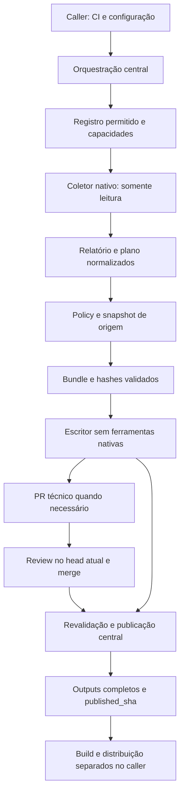

# Versionamento de packages: design de integração

**Spec:** [spec.md](spec.md).
**Context:** [context.md](context.md).
**Status:** desenho consolidado e tarefas derivadas; implementação não iniciada.
**Data:** 2026-10-19; consolidação em 2026-10-20.
**Autorização atual:** concluir somente os artefatos TLC e parar. A direção de composição/TypeScript e os requisitos anteriores estão aprovados. Este documento concretiza essa direção, sem executar código, workflows, pilotos ou publicação remota nesta rodada.

## Architecture Overview

Usar composição de módulos TypeScript, descritores de capacidades e portas explícitas de Git/processo/API. Essa escolha de linguagem foi confirmada pelo usuário e substitui a proposta anterior de fontes JavaScript. A ferramenta nativa calcula e prepara arquivos no leitor; serviços centrais validam policy, bundle e proveniência; somente o escritor confiável abre/atualiza PR técnico e publica tags/Releases. Distribuição de packages permanece uma etapa separada no caller.

Não construir uma classe base com métodos obrigatórios de publicação. Go/jgitver não geram PR de manifests; standard-version/Changesets/Release Please precisam preparar arquivos. Essa diferença é capacidade, não motivo para duplicar policy.

Para perfis com PR técnico, o caminho direto H -> K só existe após a integração técnica validada. O merge funcional não cria tag/Release. Para Go/jgitver, K usa diretamente o SHA funcional integrado verificado.

### Abordagem selecionada e alternativas

| Abordagem | Trade-off | Decisão |
| --- | --- | --- |
| Composição e serviços comuns sobre a base atual | Exige extrair acoplamentos de forma incremental, mas preserva contratos existentes | Selecionada, conforme direção aprovada na spec |
| Action Release Please completa paralela à pipeline | Menos adaptação inicial, mas oferece outro caminho de escrita/publicação e governança | Rejeitada |
| Reescrita em hierarquia de classes | Padroniza nomes, mas força métodos vazios/herança e aumenta o risco de migração | Rejeitada |

## Baseline and Integration Order

Confirmado por consultas read-only, reconfirmadas em 2026-10-20:

- Worktree local `versioning-reconciled/.github`, branch `codex/reconcile-native-profiles`, HEAD `93f72bf` antes desta consolidação; mudança de handoff conhecida em STATE.md.
- master central: `3511b1f1266a35d43ff12a81306514c44cc65fc5`. Inventariar seu delta relevante antes da reconciliação; não incorporar os PRs #14/#15/#16 de LLM/triagem/code review.
- PR #12: `codex/versioning-profiles` -> `master`, aberto, HEAD `c7e610117edfbe8a6338ec0d3b6703156026ef70`.
- PR #13: `codex/changesets-turbo` -> `codex/versioning-profiles`, aberto, HEAD `b1b2ec51906306c7afa5129f6557b30b9528f6b5`.
- Registro atual possui três adaptadores; Changesets ainda não está nesse registro. O PR #13 acrescenta comportamento ao fluxo anterior e não deve ser aplicado em bloco sobre o escritor atual.

A futura implementação deve continuar em um worktree próprio a partir da branch do PR #13. Preservar a base remota como ancestral, incorporar o #12 e o delta pertinente de master sem reescrever histórico e resolver conflitos por comportamento. Transportar os commits documentais locais de planejamento. Se a integração de master trouxer assunto alheio, documentar e selecionar somente o delta pertinente, sem misturar trabalho do checkout principal. Conferir novamente SHAs antes de qualquer publicação autorizada. Nenhuma dessas operações Git é executada na rodada documental.

Ordem técnica: caracterização -> toolchain e contratos/portas TypeScript -> governança -> cinco adaptadores -> serviços compartilhados de arquivos/PR/publicação -> entrypoints/workflows -> distribuição, callers e documentação -> verificador independente. [tasks.md](tasks.md) contém a sequência, os gates e a rastreabilidade. Não remover cenários ou enfraquecer assertions do #12/#13 para acomodar a conciliação; testes estruturais que verificam Bash devem passar a verificar o equivalente Node, preservando o requisito.

## TypeScript Build and Distribution

Fontes editáveis ficam em `scripts/versioning/src/`, com contratos/interfaces, adaptadores, serviços, portas e entrypoints internos. Compilar para `scripts/versioning/dist/` como JavaScript ESM; fachadas `.mjs` preservam exports usados, sem regras próprias. Durante a migração o legado pode funcionar; na entrega central final toda lógica em escopo tem fonte TS. Não manter duas implementações ativas da mesma regra. Não publicar pacote npm global, binário ou produto CLI para os consumidores.

Adicionar package.json/lockfile próprios em `scripts/versioning/` com type module e scripts typecheck/build/test/check-dist. O compilador e os tipos de Node serão fixados no lockfile da tarefa de toolchain. O package.json da aplicação consumidora não recebe esses pacotes. O SDK Release Please conserva sua instalação isolada no leitor, conforme a seção própria; não deve ser carregado transitivamente pelo grafo de imports do escritor.

Configuração projetada: strict true, noEmitOnError true, module/moduleResolution NodeNext, target ES2022, rootDir src, outDir dist, noUncheckedIndexedAccess e exactOptionalPropertyTypes habilitados. Imports de tipos são explícitos e imports de módulos usam os caminhos emitidos .js. Tipos de fronteira começam como unknown e são refinados por validadores runtime, nunca apenas convertidos por assertions.

Versionar fontes, config, lockfile e saída compilada na mesma revisão central. A CI instala o toolchain pelo lockfile, executa typecheck, recompila em diretório temporário isolado e compara a lista completa de arquivos e seus bytes com dist. Rejeitar arquivos ausentes, extras, divergentes ou symlinks. A verificação não se limita a git diff, que não detectaria sozinho arquivos novos não rastreados.

O workflow central faz checkout do próprio SHA e chama diretamente os entrypoints de dist via Node. Nenhum job consumidor compila TypeScript, baixa artifacts de compilação de outro PR ou executa ts-node/tsx. O escritor privilegiado não instala toolchain nem SDK. Inputs do caller entram por env/arquivos validados, sem interpolação de texto de PR em comandos.

Fontes são a única entrada de manutenção; dist é gerado e revisado junto, nunca editado manualmente. Testar o compilado que será entregue, além dos testes de tipos. Um teste com erro de tipo deve falhar no typecheck; um artifact/JSON malformado deve continuar sendo rejeitado em runtime mesmo quando o programa compilou.

Classes podem encapsular estado ou serviços com dependências injetadas. Interfaces modelam contratos; uniões discriminadas representam perfis único/lote e capacidades. Não criar classes vazias, service locator global, contêiner de DI ou herança para padronizar ferramentas que têm ciclos diferentes.

## Code Reuse Analysis

| Componente existente | Uso e evolução |
| --- | --- |
| `adapter-registry.mjs` | Preservar `resolveAdapter`; adicionar capacidades e os dois perfis sem carregar módulos indicados pelo caller |
| `process-runner.mjs` | Reutilizar confinamento, ambiente sanitizado, timeout de 120s e stdout de 1MiB; não apresentar como sandbox |
| `version-report.mjs` | Preservar schema1 de release única e funções SemVer de validação/comparação; cálculo continua nativo |
| `release-policy.mjs` | Única implementação de milestone/override; projetar lote unitário para esse contrato e bloquear milestone em lote múltiplo |
| `git-inputs.mjs` | Capturar/revalidar origem e refs, aceitando em retry somente as próprias tags idênticas no mesmo SHA |
| `version-bundle.mjs` | Extrair transporte de arquivos e validação estrutural, mantendo API/schema legado do standard-version |
| `version-pr.mjs` | Reusar redução dos reviews efetivos e aprovação humana no head; separar identidade/proveniência de validação específica dos manifests |
| `publish.sh` e publicador Changesets do #13 | Extrair reconciliação de tag/Release para serviço comum; preservar tag anotada Maven e preflight de todo o lote |
| `changesets-version-pr.mjs` no #13 | Reaproveitar verificações nativas de manifests/dependências/lockfile; reforçar caminhos reais, symlinks, exclusões e bytes do bundle |
| `tests/versioning/run.mjs` | Unir fixtures das branches e acrescentar contratos compartilhados, sem reduzir cobertura existente |

## Components and Interfaces

Assinaturas abaixo são contratos TypeScript, com interfaces e uniões discriminadas nos modelos/portas. Paths da tabela são relativos a scripts/versioning. Nomes e contratos serão reproduzidos nas tarefas e nos testes; as fachadas legadas preservam os imports públicos existentes.

| Componente e localização | Interface proposta | Dependências e responsabilidade |
| --- | --- | --- |
| `src/adapter-contract.ts` | `validateDescriptor(value: unknown)`, `validateReleasePlan(value: unknown)`, `planFromReport(report, descriptor)` | Validação pura de capacidades e envelope; não usa filesystem/rede |
| `src/adapter-registry.ts` | `resolveAdapter(id, implementations): AdapterDescriptor` | Registro explícito dos cinco IDs; overrides somente por injeção de código confiável nos testes |
| `src/services/versioning.ts` | `collectPlan(context, ports): Promise<ReleasePlan>` | Resolve adaptador, aguarda cálculo sync/async e valida relatório/plano; não escreve remotamente |
| `src/ports/git.ts` | `createGitPort(repository, execute): GitPort` | Consultas a refs, blobs e histórico por argv; SHA explícito, sem eval/shell concatenada |
| `src/ports/github.ts` | `createReadApi(transport): ReadApi`, `createWriteApi(transport): WriteApi` | Leitura paginada e escrita separadas; distinguir 404 de 401/403/429/5xx; não simular ausência em erro |
| `src/services/version-files.ts` | `captureBundle(context, plan, filePolicy, ports)`, `validateBundle(bundle, plan, filePolicy, ports)` | Transporte regular de bytes/exclusões, hashes e identidade; `filePolicy` é função pura confiável, não plugin do consumidor |
| `src/services/technical-release.ts` | `prepareTechnicalPr(context, plan, bundle, ports)`, `validateTechnicalMerge(context, evidence, ports)` | PR técnico e reviews/proveniência comuns; não recalcula SemVer nem executa ferramenta nativa |
| `src/services/publication.ts` | `reconcilePublication(context, plan, ports): Promise<PublicationResult>` | Preflight de todas as entradas; tags/Releases imutáveis, reconciliação e resultados parciais |
| `src/adapters/changesets.ts` | `collect(context, ports)`, `prepare(context, nativePlan, ports)` | CLI Changesets do lockfile, um plano para todo o workspace e preparação somente no leitor |
| `src/adapters/release-please.ts` | `collect(context, ports)`, `prepare(context, nativePlan, ports)` | SDK Release Please fixado; serializar plano/arquivos e notas nativos sem chamar métodos de escrita |
| `src/adapters/release-please/snapshot-scm.ts` | `createSnapshotScm(context, snapshot, ports)` | Porta nativa específica da ferramenta, restrita à origem observada; métodos mutantes sempre rejeitados |

Os adaptadores Go, jgitver e standard-version migram para src e mantêm suas assinaturas públicas por fachadas sem lógica. A orquestração usa `await` para aceitar tanto implementações síncronas existentes quanto o SDK assíncrono novo. `collect-version-report.mjs` e `verify-version-files.mjs` deixam de executar no import; entrypoints internos têm guarda explícita.

Ao migrar cada módulo, mover a implementação para src e fazer sua fachada pública reexportar o compilado. Tipar as dependências de leitura e de escrita separadamente, sem tratar tipagem como mecanismo de segurança suficiente. As portas e os jobs continuam aplicando as restrições efetivas em runtime.

O Bash próprio sai do fluxo final. Wrappers transitórios, se necessários durante commits intermediários, são removidos depois de migrar workflows, testes e referências documentais. `run: node ...` ainda é lançado pelo shell do runner; Maven/npm podem ter launchers próprios. O critério de retirada mede scripts e regras que mantemos, não a ausência de shell em todas as dependências.

### Inventário obrigatório da migração

T1 confere este inventário contra master/#12/#13/local. Cada caminho em escopo precisa de destino TS e gate; eventual novo arquivo encontrado entra no inventário antes da implementação.

| Origem central | Destino por responsabilidade | Tarefas |
| --- | --- | --- |
| paths.sh, process-runner.mjs | src/ports/process.ts: argv, paths, ambiente, limites | T4 |
| git-inputs.mjs, collect-origin-report.sh | src/ports/git.ts: origem, refs, snapshot e retry | T5 |
| collect-pr-policy.sh | src/ports/github.ts e src/services/pr-evidence.ts: API, timeline, reviews | T6, T9 |
| version-report.mjs, adapter-registry.mjs, resolve-adapter.sh | src/adapter-contract.ts e src/adapter-registry.ts: normalização/validação, registro | T7 |
| version.mjs, validate-sprint.sh | Retirar funções antigas de cálculo paralelo/issues-épicas sem reproduzi-las; portar apenas validações ainda necessárias e redirecionar testes de tagged SHA para o contrato nativo | T7, T11, T27 |
| release-policy.mjs, release-gates.sh | src/services/release-policy.ts e pr-evidence.ts: policy e CI/SHA | T8, T9 |
| homologation-guide.mjs/.sh | src/services/homologation-guide.ts | T10 |
| adapters/go-gitsemver.mjs | src/adapters/go-gitsemver.ts | T11 |
| adapters/jgitver.mjs, java-properties.mjs, install-maven.sh | src/adapters/jgitver.ts, parser e instalação Maven com checksum | T12 |
| adapters/standard-version.mjs, install-node.sh, sync-npm-lock.mjs | src/adapters/standard-version.ts e preparo npm reutilizável | T13 |
| Coletor e preparação Changesets do PR #13 | src/adapters/changesets.ts | T14 |
| Novo perfil Release Please | src/adapters/release-please/snapshot-scm.ts e release-please.ts | T15, T16 |
| version-bundle.mjs, verify-version-files.mjs, changesets-version-pr.mjs | src/services/version-files.ts e políticas puras de arquivos por perfil | T17 |
| prepare-version-pr.sh, version-pr.mjs, validate-version-pr.sh | src/services/technical-release.ts e technical-merge.ts | T18, T19 |
| publish.sh, publish-changesets.mjs | src/services/publication.ts | T20 |
| prepare-release.sh | Casos Go de SHA/tag migram para coletor/publicador TS; não preservar seleção antiga de package nem algoritmo paralelo | T11, T20, T27 |
| collect-version-report.mjs/.sh, preview.sh | src/services/versioning.ts e src/entrypoints/preview.ts | T21 |
| prepare-publication.sh | src/entrypoints/prepare-publication.ts | T22 |
| Invocação de escrita, outputs e artifacts | src/entrypoints/publish.ts | T23 |
| Referências YAML/testes/docs a esses caminhos | Chamadas Node e contratos comportamentais preservados | T24–T27, T30–T32 |

Os arquivos auxiliares estritamente necessários a um componente e seus testes acompanham a mesma tarefa. O inventário não inclui automações de LLM, SonarQube, triagem ou code review. Scripts históricos OpenSpec permanecem como histórico, sem serem executados pelo fluxo central.

### Capacidades por adaptador

| ID | Runtime | Resultado | Arquivos nativos / PR técnico | Tag |
| --- | --- | --- | --- | --- |
| go-gitsemver | Go | Único | Não | Lightweight, prefixo v existente |
| jgitver | Java/Maven | Único | Não | Anotada, prefixo configurado e validado |
| standard-version | Node | Único | Sim | Lightweight, contrato existente |
| changesets | Node | Lote | Sim | Lightweight, `<package>@<version>` |
| release-please | Node | Único neste perfil | Sim | Lightweight, v neste primeiro perfil |

Um lote Changesets continua sendo lote com uma entrada; somente a projeção dos outputs escalares varia. O nome do package e seu caminho vêm do inventário de workspaces, não de inferência livre do escritor.

## Data Models

### Contexto e resultado

`AdapterContext` contém `repository`, `workspace`, `projectPath`, `targetBranch`, `sha` funcional completo, `tagPrefix` e configuração validada. Tokens não fazem parte do modelo nem dos artifacts. Portas de transporte recebem credenciais do job fora desses objetos serializados.

`AdapterDescriptor` contém `id`, `runtime`, `reportKind: single|batch`, `needsVersionPr`, `tagKind`, `collect` e, quando aplicável, `prepare`. Validar a presença coerente das funções e capacidades, sem métodos vazios para ferramentas que não preparam arquivos.

`ReleasePlan` é envelope interno com `schemaVersion: 1`, `adapter`, `sha`, `branch`, `status: release|no-release`, `report`, `entries` e `planDigest`. Cada entrada contém `package` (null no perfil de aplicação sem package), `projectPath`, `baseVersion`, `version`, `bump`, `tag`, `tagKind` e `notes`. Ordenação canônica por package/path/tag; nenhuma função executável ou objeto SDK é serializado.

O `report` preserva a evidência nativa e o schema de cada perfil. O envelope não substitui os outputs públicos existentes. A validação de incremento apenas compara base e candidata, sem decidir uma versão alternativa.

`VersionBundle` de novos perfis usa schema2: identidade de adapter/origem/projeto, digest do plano, hashes de configuração/lockfile, lista de operações `write|delete`, path, hash anterior e conteúdo/hash posterior quando houver escrita. Exclusão é permitida apenas para changesets consumidos identificados no plano. O standard-version continua aceitando/produzindo seu bundle schema1 na interface legada; o serviço adapta internamente sem enfraquecer seu limite de quatro arquivos.

Limites iniciais dos novos bundles: 10MiB de bytes totais, 16MiB serializados, 100 releases e 1000 operações. Limite excedido gera falha antes de aplicar qualquer operação. Todos os paths são relativos/confinados; rejeitar duplicatas, symlinks inclusive em diretórios ancestrais, paths absolutos, traversal e arquivos não regulares. Validar toda a lista antes da primeira aplicação. Os testes cobrem cada limite e igualdade na fronteira.

`PublicationResult` contém outcome, `publishedSha` somente após sucesso completo, entradas por status `existing|created|pending|conflict` e URLs verificadas. Falha parcial preserva evidência local por entrada, mas não exporta `published_sha` de sucesso nem libera distribuição.

### Identidades e governança entre fases

Nomear separadamente `functionalSha` (origem do cálculo), `reviewedHeadSha` (head técnico aprovado) e `publishedSha` (commit integrado efetivamente publicado). Nunca preencher um com outro por conveniência. Validar árvore/diff e relação de merge para o método suportado; a CI precisa corresponder ao SHA integrado publicado.

O `functionalPrNumber` liga o plano à origem. Milestone/override são coletados desse PR novamente antes da escrita. Alteração ou remoção de milestone é reavaliada pelas regras atuais; ausência continua aceitando cálculo nativo. Qualquer mudança invalida o snapshot anterior; se houver PR técnico preparado, regenerar a evidência e exigir revisão atualizada em vez de reaproveitar uma autorização antiga. A aprovação técnica comprova o conteúdo do bundle e não substitui as duas pessoas do override funcional. Títulos, labels ou metadados ausentes no PR técnico não mudam a origem dessa policy.

Artifact confiável pertence ao mesmo repositório, run/job leitor esperado e SHA central verificado. Conferir essas identidades pela API/contexto confiável e registrar SHA funcional, hash de config/lockfile e digest do plano. O hash contido no próprio arquivo só prova integridade interna, não autenticidade. Capacidades privilegiadas sempre vêm do registro do checkout central, nunca do caller/artifact.

## Release Please Profile

### Dependência e modo nativo

Fixar `release-please@17.11.2`, Node24, em manifest/lockfile próprios sob `scripts/versioning/tools/release-please/`, não no package.json do consumidor. A instalação usa diretório absoluto explícito, `npm ci --ignore-scripts` no leitor e nunca busca prefixo em diretórios ancestrais. O escritor não instala nem importa o SDK. A instalação/geração do lockfile pertence à tarefa de implementação, ainda não executada.

Usar a API nativa `Manifest.buildPullRequests()` com SCM de snapshot para produzir candidata, notas e updaters. Materializar as alterações nativas no leitor e converter apenas bytes/dados para bundle. Na fase técnica, `Manifest.buildReleases()` pode construir a candidata nativa a partir do PR integrado observado, sempre em leitura e selecionando somente o PR autorizado. Não usar `createPullRequests()`, `createReleases()`, a action completa ou um comando CLI que misture planejamento e escrita.

O SDK e seus métodos existem no tag upstream fixado. Isso é evidência de desenho, não de execução bem-sucedida: a tarefa do perfil deve provar o funcionamento real, a ausência de chamadas mutantes e a identidade do snapshot.

### Configuração suportada

Primeiro perfil: um componente na raiz (`project_path: .`), `release-type: node`, tag `v<version>`, package-lock.json obrigatório, sem workspaces. Aceitar JSON nativo `release-please-config.json` e `.release-please-manifest.json`. A entrada única de packages é `.`. O manifest conserva a semântica nativa; sem baseline ele não pode ser tratado como prova de release inexistente.

Permitir apenas: release-type node, packages com entrada única, include-component-in-tag false, include-v-in-tag true, changelog-path CHANGELOG.md, changelog-type default, changelog-sections validadas, bump-minor-pre-major/bump-patch-for-minor-pre-major booleanos, versioning default e initial-version estável para bootstrap. Aceitar `$schema` como metadado sem buscar URL remota. Rejeitar opções desconhecidas, plugins, extra-files, release-as e supressão de changelog/release. Não usar o título da milestone para preencher configuração.

O SDK nativo usa 1.0.0 como primeira versão quando não há configuração; exigir initial-version 0.0.1 no bootstrap suportado. A ferramenta deve produzir a candidata; se não produzir 0.0.1 sem baseline, o gate bloqueia. Não criar tag 0.0.0 nem substituir a candidata. Manifest/tag/Release existentes precisam apontar para a mesma base reconhecida; divergência exige diagnóstico e ajuste humano de adoção.

O Node updater nativo também pode tocar samples/package.json e changelog.json se existirem. Eles não são autorizados silenciosamente neste perfil. Detectar operação efetiva nesses paths e falhar como formato não suportado. Allowlist efetiva do bundle: package.json, package-lock.json, CHANGELOG.md e .release-please-manifest.json. O config JSON não é gerado no PR técnico.

### Snapshot e protocolo de PR

Congelar arquivos e commits no SHA funcional do plano. O SCM traduz leituras da branch lógica para esse SHA; commits/tag/releases são coletados com paginação completa e SHA verificado. Leituras de refs não resolvidas para a origem esperada falham. Consultas GraphQL somente por operações de leitura fixas; negar mutações mesmo quando transportadas por POST. No fixture, a porta rejeita qualquer operação mutante e qualquer conexão não prevista.

Identidade estável de PR: repositório + branch-alvo + componente. Manter um único PR aberto; sua branch técnica é exclusiva da automação. Na atualização, construir a árvore a partir da nova origem funcional e aplicar somente o bundle validado. O commit de atualização tem como pais o head técnico anterior e a nova origem funcional; assim o update de ref é fast-forward e não carrega arquivos de versão antigos para a árvore nova. Revalidar ambos os pais, a árvore resultante e o diff contra a origem atual. Head técnico com alteração não reconhecida da automação bloqueia a atualização, sem force-push nem segundo PR concorrente. Todo novo plano altera digest/origem e invalida aprovações antigas.

Corpo do PR contém bloco de proveniência central separado do corpo nativo, sem retirar os dados necessários à interpretação nativa. Título/corpo/labels ajudam a localizar o PR; somente diff, hashes, identidade da automação, origem e reviews efetivos autorizam publicação. Labels `autorelease:*` não são autorização.

O merge técnico deve conservar a relação verificável com a origem funcional e o plano revisado. Merge, squash e rebase de um commit serão testados separadamente; método que não preservar essa relação falha sem publicação. Não estender automaticamente o suporte a histórias de rebase multi-commit.

## Changesets Reconciliation

O PR #13 testa Changesets2.29.5; o piloto Vue declara CLI3. A conciliação terá fixtures reais separadas com `@changesets/cli@2.29.5` e `@changesets/cli@3.0.3`, ambas fixadas nos respectivos lockfiles. Não inferir suporte a todas as versões major/minor nem atualizar o piloto nesta etapa.

O leitor executa status nativo, preserva releases/dependentes, roda version e sincroniza lockfile com a versão de npm registrada no fixture/consumidor. Verifica mudanças antes de capturar o bundle. O escritor só aplica bytes já aprovados; não herda o caminho antigo do #13 que executa ferramentas no preparo privilegiado.

Allowlist dinâmica confiável: manifests/changelogs dos workspaces declarados no plano, root package-lock.json e exclusões dos IDs de changesets consumidos. Pacotes alterados apenas por propagação de dependência precisam aparecer na evidência nativa e na lista de arquivos, não podem ser adicionados por conveniência do escritor.

Sem releases elegíveis: no-release e nenhuma escrita. Erro da CLI não é plano vazio. Mais de um release com milestone bloqueia antes de escrita; uma entrada projeta o contrato comum de milestone. Tags de outros namespaces não satisfazem bootstrap do package.

Publicação consulta todas as tags/Releases antes da primeira escrita. Conflito posterior ao preflight por concorrência é reconciliado por nova leitura; divergência bloqueia e registra o que já foi concluído. Não prometer transação GitHub para todo o lote.

## Workflow and Caller Boundaries

- Preservar inputs públicos existentes. `adapter` passa a aceitar os cinco IDs; nenhum módulo/caminho executável livre pode ser configurado no caller.
- Instalar somente o runtime/ferramenta selecionado no leitor; Maven/Go não passam a depender de npm do consumidor. Node continua sendo o runtime da automação central existente.
- Expor capabilities como dados ao workflow para decidir se precisa de App/PR técnico. A credencial da App só chega ao escritor que precisa abrir/atualizar o PR.
- Preservar environment opcional e serialização por repositório/destino. Após espera, revalidar metadados/reviews/refs e artifacts antes de escrita.
- Para batch com várias entradas, outputs escalares vazios; `releases_json` lista resultados completos e published_sha só existe após sucesso total. Uma entrada também preenche escalares.
- Cada exemplo consumidor terá um workflow que coordena CI, preview e publish nos eventos pertinentes. Os jobs continuam distintos; centralizar arquivo não mistura permissões ou elimina `needs`.
- Exemplos só referenciam um SHA central que contenha o contrato completo e exista no GitHub. Durante a implementação, não inserir SHA inventado ou alegar que o SHA anterior já inclui os novos perfis. Atualização final do pin é uma tarefa de entrega após autorização de push; manter evidência de pendência até lá.

## Consumer Readiness and Distribution

Esta etapa central produz fixtures, verificadores e templates; não modifica os pilotos. Adoção remota e registry permanecem tarefas bloqueadas por autorização aplicável e acesso real, não falhas presumidas da implementação.

Java: inventariar parent/BOM/core/starter e a tag 0.0.1; alinhar prefixo com a configuração nativa sem criar tag alternativa automaticamente. Validar versão efetiva e POMs que serão distribuídos, incluindo revision/dependencyManagement e parents. Um build local do reactor não comprova os POMs publicados. O caller usa published_sha e confirma peeling da tag antes do build.

Vue: inventariar tags/versões de ui/utils/composables e registry; substituir a dupla autoridade somente na adoção autorizada. A distribuição usa exclusivamente os packages do plano completo e valida nome/versão/dependências e conteúdo de tarballs. Root privado não é publicado.

Builds operam sem App key e sem credenciais de publicação. A etapa de envio recebe somente artefatos verificados e credencial do registry, sem recalcular versões. Artefatos devem registrar coordenadas, digest, SHA e run de build. Maven deploy de coordenadas existentes ou parcialmente publicadas não é retomado às cegas: inventariar e exigir intervenção quando a identidade não for comprovável.

Aceite externo Java: consumidor mínimo com repositório Maven local vazio importa BOM e starter e compila. Aceite externo Vue: instalação exata em cache npm isolado valida imports/tipos e build. Nenhum teste mock/local é registrado como esse aceite remoto.

## Error Handling Strategy

| Condição | Resposta | Escrita |
| --- | --- | --- |
| ID/capacidade/configuração não suportados | Falha de contrato com causa e campo, sem fallback | Nenhuma |
| Histórico incompleto, API indisponível ou rate limit | Falhar; não interpretar como ausência de tag/release/changeset | Nenhuma nova |
| Bundle adulterado, symlink ou hash/base divergente | Rejeitar todo o bundle antes de aplicar | Nenhuma |
| Milestone inválida ou lote múltiplo com milestone | Check bloqueado; sem override de formato | Nenhuma |
| Divergência válida sem override autorizado | Check bloqueado e auditoria do motivo | Nenhuma |
| Aprovação obsoleta ou origem funcional alterada | Invalidar preparação e exigir nova revisão | Nenhuma publicação |
| Tag em outro SHA ou Release inconsistente | Conflito, sem mover referência | Preservar existentes |
| Falha após parte do lote | Resultado parcial por entrada, published_sha vazio | Retry apenas dos ausentes consistentes |
| Registry parcial/divergente | Inventário e intervenção, sem rollback da release GitHub | Sem overwrite |
| Artifact expirado | Recoletar/verificar a mesma origem; nova origem requer revisão nova | Nenhuma até revalidar |

Erros de CLI continuam com exit não zero e stderr; formatos públicos existentes são preservados pelos testes de caracterização. Diagnósticos novos identificam adapter/fase/origem, sem tokens ou chaves. Nenhuma importação realiza I/O; CLIs têm guarda de entrypoint.

## Risks & Concerns

| Concern | Location (file:line) | Impact | Mitigation |
| --- | --- | --- | --- |
| Entrypoint executa no import | `scripts/versioning/collect-version-report.mjs:5`, `verify-version-files.mjs:3` | Teste/reuso pode executar processo ou escrever inesperadamente | Separar funções importáveis e CLI com guarda; teste sentinela de import sem I/O |
| Registro não descreve geração/lote | `scripts/versioning/adapter-registry.mjs:6` | Condicionais por ID se espalham no YAML/shell | Descriptor validado e decisões por capacidades |
| Bundle acoplado a standard-version | `scripts/versioning/version-bundle.mjs:34` | Reuso por outro perfil enfraquece allowlist ou quebra legado | Compatibilidade schema1 e novo schema2 com filePolicy confiável por perfil |
| Policy do #13 não integrada à arquitetura atual | `scripts/versioning/release-policy.mjs:45` e PR13 | Adição de lote pode contornar validação de versão única | Projeção unitária, rejeição explícita de milestone múltipla e regressões compartilhadas |
| Preparação do #13 usa fluxo anterior | `scripts/versioning/prepare-publication.sh:11`, PR13 `prepare-version-pr.sh` | Executar ferramenta nativa no job com escrita | Geração somente no leitor; escritor com sentinelas exit99 para ferramentas |
| Snapshot SCM novo no upstream Release Please | v17.11.2 `src/scm.ts:74`, `src/manifest.ts:518` | SDK pode consultar método/ref não previsto ou iniciar mutação | Allowlist de métodos e snapshot fixo; fixture real offline com mutações/rede negadas |
| Default inicial Release Please não atende primeira versão | v17.11.2 `src/strategies/base.ts:724` | Primeira versão nativa seria1.0.0, não0.0.1 | initial-version nativo explícito, teste real e bloqueio de configuração incompatível |
| Node updater toca arquivos adicionais | v17.11.2 `src/strategies/node.ts:43` | Alteração fora da allowlist ou falso suporte | Detectar arquivos efetivamente atualizados e rejeitar formatos fora do perfil |
| Fixture #13 usa CLI2 e piloto usaCLI3 | PR13 `tests/versioning/real-changesets.mjs:43` | Mudanças de output/semântica não cobertas | Matriz real2.29.5/3.0.3; não extrapolar evidência |
| PAT/App ou lifecycle scripts contaminam subprocessos | `scripts/versioning/process-runner.mjs:5` | Execução com credencial indevida | Preservar sanitização, ferramentas somente em leitura, testes negativos e logs redigidos |
| Pin de exemplo anterior não contém novos contratos | `examples/callers/` | Exemplo parece funcional, mas chama SHA antigo | Atualização do pin somente após revisão/publicação autorizada; pendência explícita antes disso |
| Tag Java sem prefixo e revision fixa | Baseline PackagesJava descrita na spec | Release e coordenadas internas podem divergir | Inventário e validação de POMs/prefixo antes de adoção; sem correção automática de tags |
| Retomada registry não atômica | PKG-07 | Duplicar ou misturar coordenadas publicadas | Digest/identidade por coordenada e intervenção se estado não verificável |
| Fontes TS e JavaScript distribuído divergentes | `scripts/versioning/src/` e `dist/` projetados | Consumidor executa bytes diferentes do código revisado | Build reprodutível isolado e comparação completa de arquivos/bytes na CI; testar o compilado |
| Compilação ou import do SDK no escritor | Grafo de módulos e jobs projetados | Aumentar superfície privilegiada ou exigir dependências no consumidor | Nenhum tsc/loader/install no escritor; imports nativos apenas no leitor e testes de grafo/contrato |

## Test Strategy and Requirement Mapping

Testes serão derivados das expectativas dos critérios da spec, não da saída que o código novo produzir. Preservar a suíte determinística atual e os testes reais Go, Maven e standard-version. Acrescentar testes antes de cada extração de comportamento e observar RED -> GREEN para comportamento novo.

| Requirement | Evidência planejada |
| --- | --- |
| PKG-01 | Baselines reais, união das fixtures e ausência de remoção de assertions/casos; envio remoto permanece pendente |
| PKG-02 | CLI2/3 reais: major core3.0.0 e dependente cli1.0.1 na fixture já existente; propagação, no-release, privado e erro nativo |
| PKG-03 | Bundle adulterado, paths/symlinks/exclusões, review dismissed/head antigo/bot, origem avançada e escritor com ferramenta sentinela |
| PKG-04 | Rotas normal/hotfix, milestone ausente/válida/inválida/divergente, duas pessoas no override e environment opcional |
| PKG-05 | Preflight de lote, falha na primeira tag/Release, retry idêntico/parcial, concorrência e conflito no segundo package |
| PKG-06 | Contratos YAML, caller único por consumidor, namespace/bootstrap, baseline do piloto read-only e publicação encadeada por output |
| PKG-07 | Inspeção de POM/tarball local e fixtures de distribuição; publicação/instalação externa ficam explicitamente pendentes até execução autorizada |
| PKG-08 | Matriz requisito/caso/run/SHA com cenários não executados pendentes; verificador independente e mutantes |
| PKG-09 | SDK real17.11.2 com SCM controlado: fix1.0.1, feat1.1.0 e breaking2.0.0 desde1.0.0; bootstrap0.0.1, no-release e PR atualizado |
| PKG-10 | Testes de contratos, capacidades, import sem I/O, adaptador substituto confiável e portas sentinela; regressão completa dos cinco perfis |
| PKG-11 | Typecheck positivo/negativo, noEmitOnError, dist ausente/extra/divergente, execução do compilado sem compilador e JSON inválido rejeitado em runtime |

Comandos existentes a preservar: `node tests/versioning/run.mjs --local`, `node tests/versioning/real-standard-version.mjs`, `node tests/versioning/real-standard-bootstrap.mjs`, `node tests/versioning/real-jgitver.mjs`, `node tests/versioning/real-maven-reactor.mjs`, `node tests/versioning/real-jgitver-prefix.mjs`, `node tests/versioning/maven-setup.mjs` e `node tests/versioning/run.mjs --real-go`. Os comandos novos e nomes exatos dos testes serão definidos em Tasks. Git Bash explícito no Windows evita o bash de WSL não instalado; CI Linux valida permissões POSIX dos fixtures.

Gates documentais agora: `validate_spec.py --strict` e `git diff --check`. Eles não comprovam o comportamento deste design. Depois da implementação, o verificador independente deve rederivar o aceite e injetar falhas de SHA, autorização e publicação parcial em scratch isolado. A fase B/C só passa com evidência remota real.

## Tech Decisions

| Decision | Choice | Rationale |
| --- | --- | --- |
| Runtime/linguagem | Toda lógica central em TypeScript estrito e entrypoints Node compilados, sem .sh próprios no fluxo final | Escolha do usuário para manutenção; YAML continua a orquestrar sem instalar CLI na aplicação |
| Distribuição | src e dist versionados juntos, lockfile central e CI de correspondência | Runtime disponível no SHA selecionado sem instalar toolchain no escritor |
| POO | Contratos, encapsulamento e composição; sem classe base obrigatória | Ferramentas têm ciclos e capacidades distintos |
| Release Please | SDK17.11.2 fixado, isolado no checkout confiável | Reprodutibilidade e nenhum requisito de instalar SDK em toda aplicação |
| Escrita | Somente serviços centrais após policy e validação de evidência | Preservar AD-001/002/003 e evitar bot concorrente |
| Compatibilidade | Schema/inputs/outputs/erros preservados; fachadas JS sem lógica, scripts Shell internos retirados | Caller usa workflow_call; pins antigos conservam o código antigo, sem manter legado ativo no pin novo |
| Migração | Incremental com caracterização por etapa | Separar regressão da refatoração de comportamento novo |
| Ship gate | Evidência local, revisão independente, CI hospedada e piloto são resultados distintos | Não encerrar issue nem afirmar homologação por CI central verde |

AD-001/002/003 permanecem ativos. AD-005 amplia AD-004 para a migração completa em escopo e explicita que não há produto CLI independente. Escolhas específicas de versão/perfil/bundle desta entrega permanecem neste documento.

## Official Research References

Context7 indisponível nesta sessão. Conferidos código/docs do tag fixado, não apenas o README de main:

- [Release Please17.11.2 package.json](https://github.com/googleapis/release-please/blob/v17.11.2/package.json): versão e Node>=22, compatível com runtime24 projetado.
- [Exports públicos](https://github.com/googleapis/release-please/blob/v17.11.2/src/index.ts) e [Manifest](https://github.com/googleapis/release-please/blob/v17.11.2/src/manifest.ts): construção de candidatos separada de operações create.
- [SCM](https://github.com/googleapis/release-please/blob/v17.11.2/src/scm.ts): contrato nativo que será limitado pelo snapshot adapter.
- [Node strategy](https://github.com/googleapis/release-please/blob/v17.11.2/src/strategies/node.ts) e [BaseStrategy](https://github.com/googleapis/release-please/blob/v17.11.2/src/strategies/base.ts): arquivos atualizáveis e bootstrap nativo.
- [Changesets3 CLI](https://changesets.dev/guide/cli): plano, versionamento e distribuição são fases distintas. Compatibilidade2/3 precisa dos testes reais citados.
- [TypeScript módulos Node](https://www.typescriptlang.org/docs/handbook/modules/reference.html), [strict](https://www.typescriptlang.org/tsconfig/strict.html) e [noEmitOnError](https://www.typescriptlang.org/tsconfig/noEmitOnError.html): referências oficiais do desenho de compilação; gates ainda não executados nesta etapa documental.
- [GitHub Actions run e shell](https://docs.github.com/en/actions/reference/workflows-and-actions/workflow-syntax#jobsjob_idstepsrun): lançar Node por run não elimina o shell de lançamento do runner. A retirada é da implementação Shell própria, não de mecanismos internos das ferramentas.

## Approval Gate

A direção e os requisitos aprovados foram consolidados em tarefas atômicas com testes no mesmo commit. A instrução mais recente exige parar ao completar estes documentos. Nenhuma tarefa será iniciada nesta rodada. Na futura retomada, preservar execução neste chat e o verificador independente ao final da implementação; validação documental não é o PASS de implementação exigido pelo TLC/AGENTS.md.
